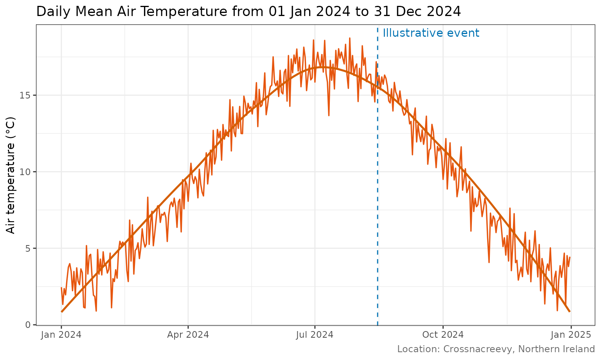

# Customising crossmet plots with ggplot2

## Plotting functions return ggplot objects

The plotting functions in **crossmet** return ordinary
[`ggplot2::ggplot()`](https://ggplot2.tidyverse.org/reference/ggplot.html)
objects. This means you can save them in variables, inspect them, and
extend them with the same layers and scales you use in any other ggplot2
workflow.

For example, create a mean air temperature plot and check its class:

``` r

temperature_plot <- MeanAirTempPlot(sample_weather)

inherits(temperature_plot, "ggplot")
#> [1] TRUE
```

The result is `TRUE`: the returned object is a ggplot object, not a
static image. You can therefore add layers with the `+` operator.

## Add a geom and annotate an event

The following example adds a smoothed trend line to the daily
observations. It then marks an illustrative event date with a vertical
line and a text annotation. Replace the example date and label with an
event relevant to your own analysis (for example, a storm, frost,
equipment change or management intervention).

``` r

event_date <- as.Date("2024-08-15")

temperature_plot +
  geom_smooth(
    method = "loess",
    formula = y ~ x,
    se = FALSE,
    colour = "#D55E00",
    linewidth = 0.9
  ) +
  geom_vline(
    xintercept = as.numeric(event_date),
    linetype = "dashed",
    colour = "#0072B2"
  ) +
  annotate(
    "text",
    x = event_date,
    y = Inf,
    label = "Illustrative event",
    vjust = 1.5,
    hjust = -0.05,
    colour = "#0072B2"
  )
#> Warning in scale_x_date(date_labels = "%b %Y"): A <numeric> value was passed to a Date scale.
#> ℹ The value was converted to a <Date> object.
```



Here, `geom_smooth()` inherits the data and aesthetic mappings from the
original crossmet plot. The event marker is added as another ggplot2
layer; `annotate()` places a label at the same date. No changes to the
package plotting function are needed.

## Extend other crossmet plots

The same approach works with the other plotting functions. For example,
add a point layer to a rainfall plot, or change its labels and theme:

``` r

rainfall_plot <- RainfallPlot(sample_weather)

rainfall_plot +
  labs(
    title = "Daily rainfall at Crossnacreevy",
    subtitle = "Add your own explanatory subtitle",
    caption = "Source: Crossnacreevy weather observations"
  ) +
  theme_minimal()
```

You can use any compatible ggplot2 layer, scale, coordinate system or
theme. For details, see the [ggplot2
documentation](https://ggplot2.tidyverse.org/). The examples in this
vignette use synthetic data only and do not represent actual station
measurements.
