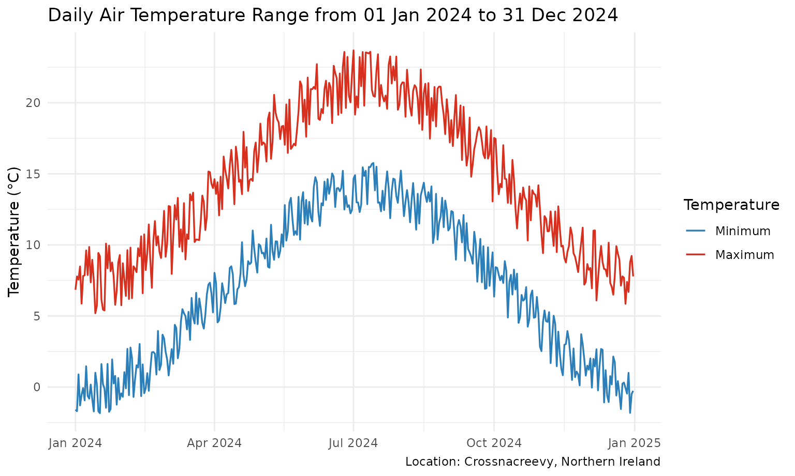
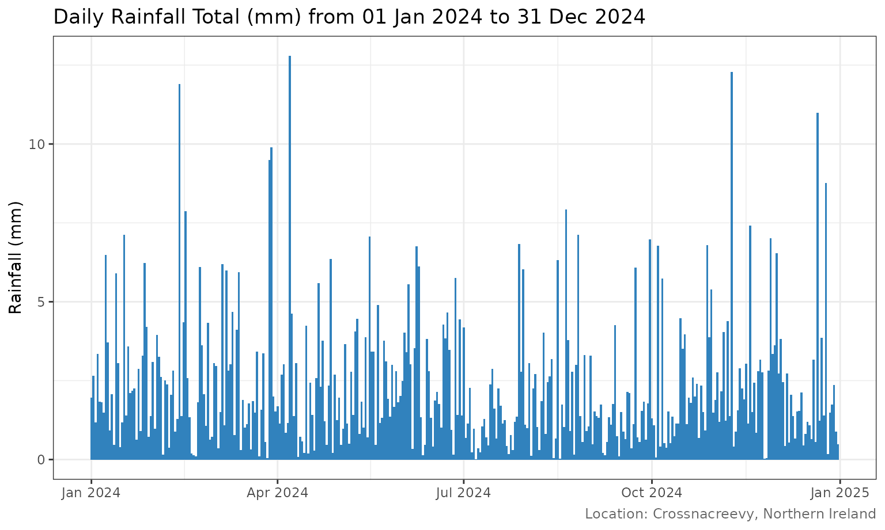
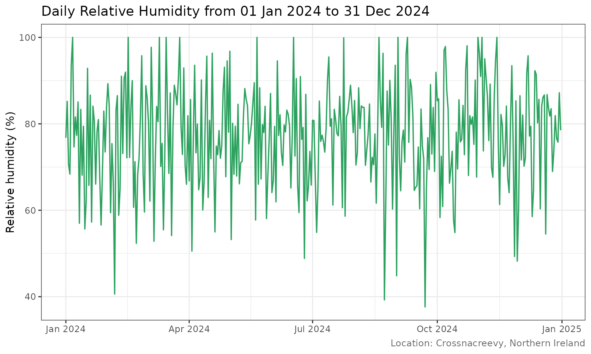
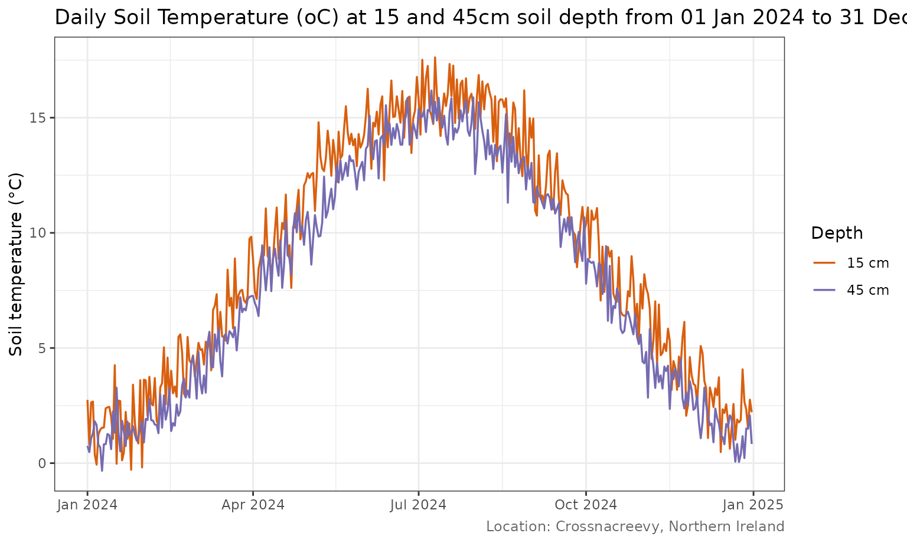
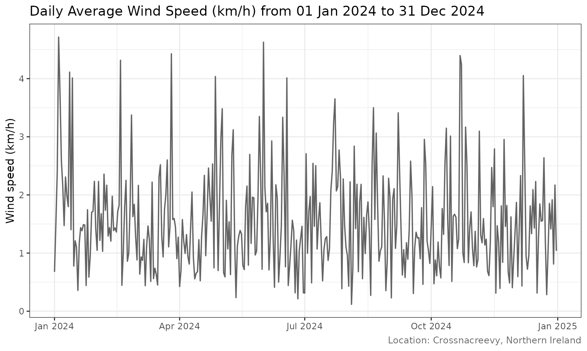
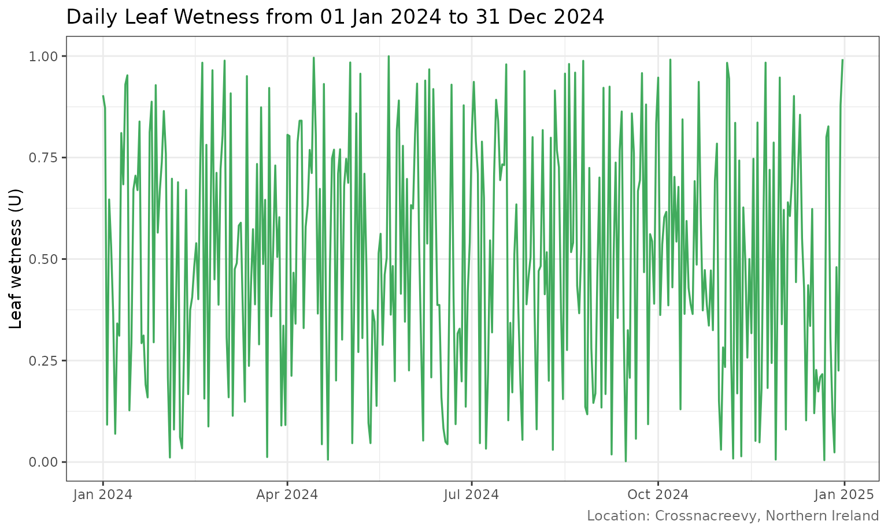
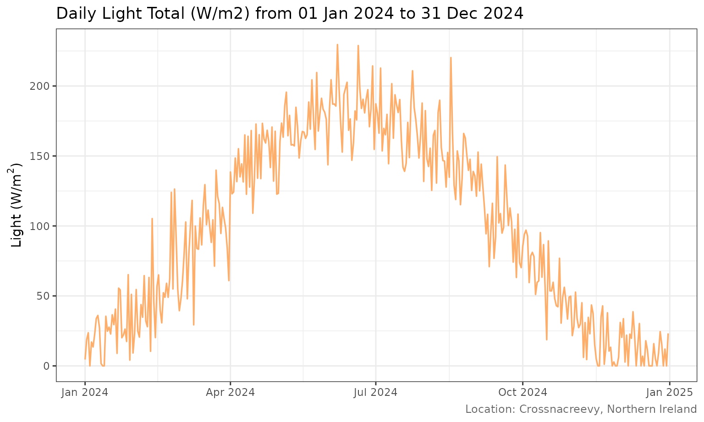
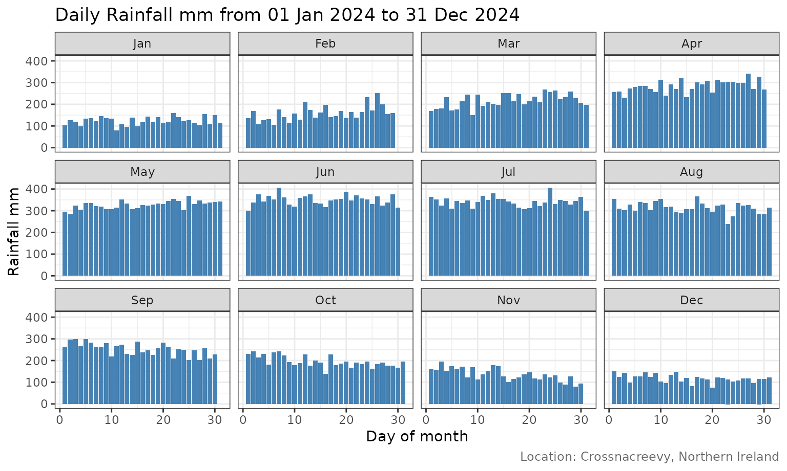
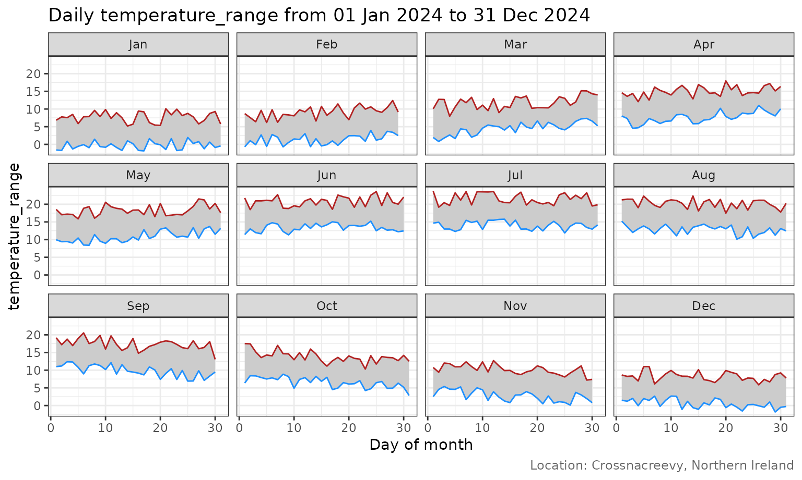

# Weather graph gallery

## About this gallery

The plots below demonstrate the package’s plotting functions using a
reproducible **synthetic** year of daily observations. They illustrate
plot types and layout only; they are not actual Crossnacreevy station
data.

### Air temperature

Daily minimum and maximum temperature are shown together to highlight
the diurnal range and seasonal cycle.

``` r

TemperaturePlot(sample_weather)
```



### Rainfall

Daily rainfall is shown as a time series of daily totals.

``` r

RainfallPlot(sample_weather)
```



### Relative humidity

``` r

RelativeHumidityPlot(sample_weather)
```



### Soil temperature

The soil temperature plot compares the 15 cm and 45 cm measurements.

``` r

SoilTempPlot(sample_weather)
```



### Wind speed

``` r

WindSpeedPlot(sample_weather)
```



### Leaf wetness and light

``` r

LeafWetnessPlot(sample_weather)
```



``` r

SolarRadPlot(sample_weather)
```



### Monthly grid: daily rainfall

Each panel represents a calendar month, with day of month on the
horizontal axis.

``` r

PlotMonthlyGrid(sample_weather, variable = "Rainfall mm")
```



### Monthly grid: temperature range

The shaded ribbon spans the daily minimum and maximum temperatures.

``` r

PlotMonthlyGrid(sample_weather, variable = "temperature_range")
```



### Exporting plots

Use \`SaveWeatherPlots()\` to write selected plots and monthly grids to
a directory. The function invisibly returns the paths of the files
created.

``` r

files <- SaveWeatherPlots(
  sample_weather,
  plots = c("temperature", "rainfall", "relative_humidity"),
  monthly_grids = TRUE,
  path = "weather-plots"
)
files
```
